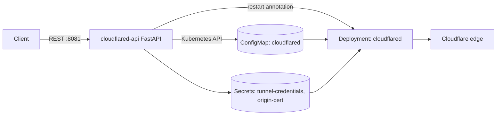

# cloudflared-dns-propagation

A small FastAPI service that manages [Cloudflare Tunnel](https://developers.cloudflare.com/cloudflare-one/connections/connect-networks/) (`cloudflared`) hostname routes running in Kubernetes. It stores tunnel credentials as Kubernetes Secrets and adds, removes and lists ingress hostnames in the `cloudflared` ConfigMap, then restarts the `cloudflared` Deployment.

## Overview

The API (`main.py`, `routes/domain.py`) talks to the Kubernetes API using the in-cluster config, falling back to your local kubeconfig. All resources are in the `default` namespace.

| Endpoint | Method | Purpose |
|----------|--------|---------|
| `/v1/domain/setup` | POST | Create/replace the `tunnel-credentials` and `origin-cert` Secrets |
| `/v1/domain/add-dns` | POST | Add (or update) a `hostname` -> `service` ingress rule in the `cloudflared` ConfigMap and restart the Deployment |
| `/v1/domain/remove-dns` | DELETE | Remove a hostname from the ConfigMap and restart the Deployment |
| `/v1/domain/list-dns` | GET | List hostnames in the `cloudflared` ConfigMap |

Note: this service does not call the Cloudflare API. The DNS CNAME record pointing at `<TUNNEL_ID>.cfargotunnel.com` must be created separately (see below).

## Architecture



## Prerequisites

- Python 3 with `fastapi`, `uvicorn`, `kubernetes` (see `requirements.txt`; the Dockerfile uses Python 3.9)
- A Kubernetes cluster and `kubectl` access
- A Cloudflare account with a domain, and the [`cloudflared`](https://developers.cloudflare.com/cloudflare-one/connections/connect-networks/downloads/) CLI

## Quick start

### 1. Create the tunnel

```bash
cloudflared tunnel login                      # produces cert.pem
cloudflared tunnel create example-tunnel      # produces <TUNNEL_ID>.json credentials
```

### 2. Create the Kubernetes secrets

```bash
kubectl create secret generic tunnel-credentials \
  --from-file=credentials.json=$HOME/.cloudflared/<TUNNEL_ID>.json
kubectl create secret generic origin-cert \
  --from-file=origin-cert.pem=$HOME/.cloudflared/cert.pem
```

Alternatively, call `POST /v1/domain/setup` once the API is running (see Usage).

### 3. Deploy

The `manifest/` directory contains `cm.yaml` (cloudflared config), `deploy.yaml` (cloudflared and cloudflared-api Deployments), `permissions.yaml` (Roles and RoleBindings for the `default` service account) and `secert.yaml` (Secrets, see the security note below). Edit the tunnel name, image references and secret names to match your environment, then:

```bash
kubectl apply -f manifest/cm.yaml -f manifest/permissions.yaml -f manifest/deploy.yaml
```

### 4. Point DNS at the tunnel

In the Cloudflare dashboard (DNS tab) create a proxied CNAME for your hostname targeting `<TUNNEL_ID>.cfargotunnel.com`, or use the Cloudflare API:

```bash
curl -X POST "https://api.cloudflare.com/client/v4/zones/<ZONE_ID>/dns_records" \
  -H "Authorization: Bearer <API_TOKEN>" \
  -H "Content-Type: application/json" \
  --data '{"type":"CNAME","name":"<subdomain>","content":"<TUNNEL_ID>.cfargotunnel.com","ttl":1,"proxied":true}'
```

### 5. Run the API locally

```bash
pip install -r requirements.txt
python3 -m uvicorn main:app --reload --host 0.0.0.0 --port 8081
```

Or build the image from the `Dockerfile` (exposes port 8081).

## Usage

Set up credentials (`certpem` must be base64 encoded):

```bash
curl -X POST http://localhost:8081/v1/domain/setup -H "Content-Type: application/json" -d '{
  "TunnelIDData": {"AccountTag": "<ACCOUNT_TAG>", "TunnelSecret": "<TUNNEL_SECRET>", "TunnelID": "<TUNNEL_ID>"},
  "certpem": "<BASE64_CERT_PEM>"
}'
```

Add, list and remove a hostname:

```bash
curl -X POST http://localhost:8081/v1/domain/add-dns -H "Content-Type: application/json" \
  -d '{"hostname":"app.example.com","service":"http://my-service:80"}'
curl http://localhost:8081/v1/domain/list-dns
curl -X DELETE http://localhost:8081/v1/domain/remove-dns -H "Content-Type: application/json" \
  -d '{"hostname":"app.example.com"}'
```

## Configuration

There are no environment variables. Behaviour is fixed in code: namespace `default`, Deployment `cloudflared`, ConfigMap whose name contains `cloudflared`, Secrets `tunnel-credentials` and `origin-cert`. Never commit real tunnel credentials, `cert.pem` or API tokens.

## Project structure

```
.
├── main.py              # FastAPI app (CORS allows all origins)
├── routes/domain.py     # /v1/domain endpoints
├── Dockerfile
├── requirements.txt
└── manifest/            # Kubernetes manifests (ConfigMap, Deployments, RBAC, Secrets)
```

## Security notes

- The API has no authentication and CORS is open to all origins; restrict access (network policy, auth proxy) before exposing it.
- `manifest/permissions.yaml` grants the `default` service account broad rights (including Secrets) in the namespace.
- Treat `manifest/secert.yaml` as a template: replace values with your own and do not commit them.

## Troubleshooting

- `ConfigMap with name containing 'cloudflared' not found`: apply `manifest/cm.yaml` first.
- A 500 from the API usually carries the Kubernetes error; check the service account's RBAC (`manifest/permissions.yaml`).

## References

1. [Cloudflare Developers: Many Cloudflare Tunnels, One Tunnel](https://developers.cloudflare.com/cloudflare-one/tutorials/many-cfd-one-tunnel/)
2. [Cloudflare Argo Tunnel Examples: Named Tunnel in Kubernetes](https://github.com/cloudflare/argo-tunnel-examples/blob/master/named-tunnel-k8s/cloudflared.yaml)
3. [Creating Cloudflare Tunnels on Ubuntu](https://tcude.net/creating-cloudflare-tunnels-on-ubuntu/)

## License

[MIT](LICENSE)

## Author

Umesh Khatiwada - https://github.com/umesh-khatiwada
